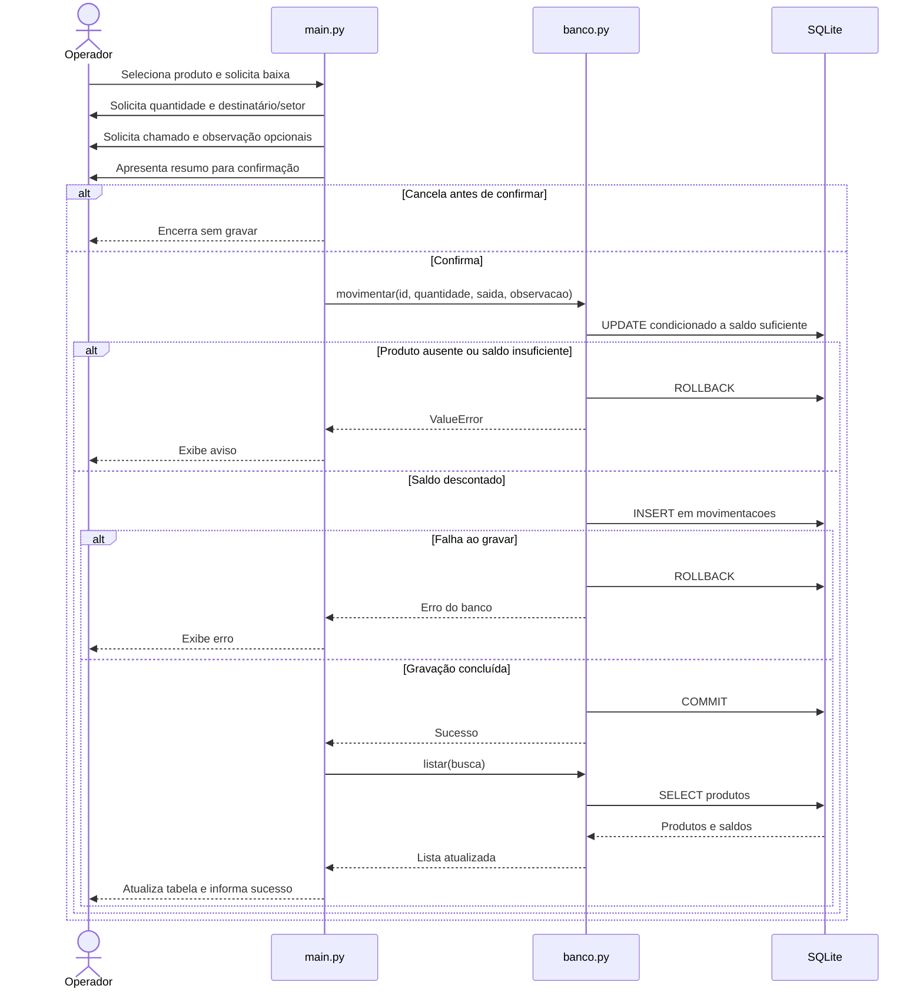
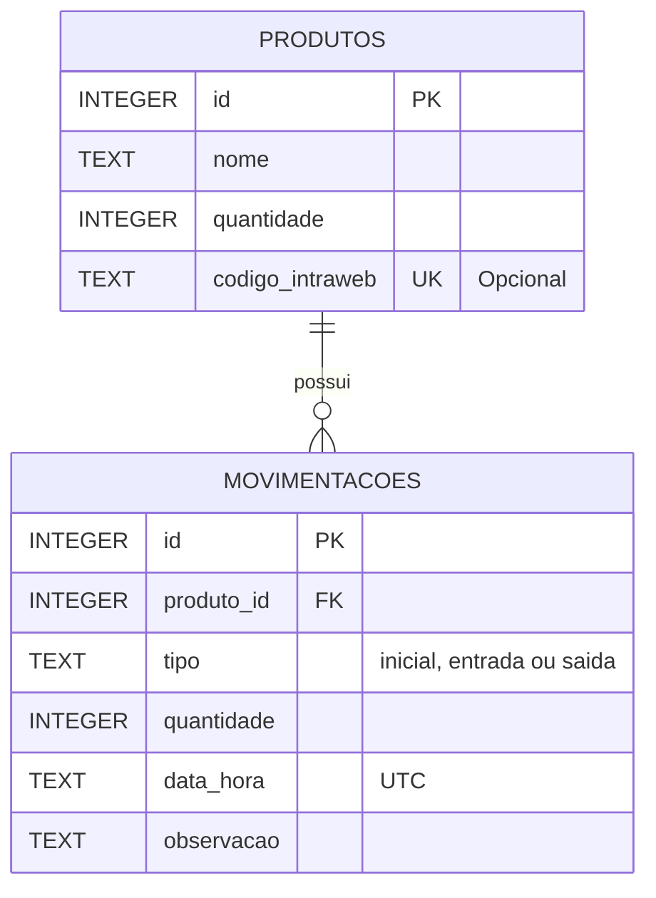

# UML e modelo de dados — Estoque TI — CN

Documentação baseada no `main.py` fornecido, na correção dos botões e na última versão de `banco.py` apresentada durante a construção. O arquivo local final de `banco.py` não foi anexado para comparação. O código é procedural: os diagramas não pressupõem classes que não existem.

## 1. Casos de uso

Ator: **operador do estoque**, a pessoa que utiliza a aplicação. O destinatário de uma entrega é uma informação preenchida pelo operador; não há login ou acesso do destinatário ao sistema.

| Caso de uso | Resultado |
| --- | --- |
| Cadastrar produto | Cria cadastro e registro de saldo inicial |
| Consultar produtos | Lista e filtra por nome ou código |
| Editar cadastro | Atualiza nome e código, preservando saldo |
| Excluir cadastro vazio | Remove apenas cadastro elegível, após confirmação |
| Receber estoque | Aumenta saldo e registra origem |
| Dar baixa por entrega | Diminui saldo e registra destinatário e chamado opcional |
| Consultar histórico | Exibe os registros do produto selecionado |

O diagrama UML de casos de uso está no arquivo [casos-de-uso.puml](casos-de-uso.puml).

## 2. Diagrama UML de sequência: baixa por entrega

A entrada segue o mesmo fluxo transacional, somando a quantidade e registrando a origem. Na saída, quantidade deve ser positiva e destinatário/setor preenchidos. O chamado é opcional. O histórico não é alterado quando há cancelamento ou saldo insuficiente.

## 3. Modelo entidade-relacionamento

Este é um diagrama ER, complementar ao UML, que representa as tabelas reais do SQLite.

A chave estrangeira exige que cada movimentação pertença a um produto. O banco permite zero ou várias movimentações por produto; o fluxo da aplicação cria um saldo inicial para cada cadastro. `ON DELETE RESTRICT` impede remover um produto enquanto houver registros vinculados. A função de exclusão remove antes apenas o registro inicial zerado de um cadastro elegível.

## 4. Onde cada informação fica

| Informação | Armazenamento |
| --- | --- |
| Nome e código atual | `produtos.nome`, `produtos.codigo_intraweb` |
| Saldo atual | `produtos.quantidade` |
| Quantidade da operação | `movimentacoes.quantidade` |
| Data e hora | `movimentacoes.data_hora` |
| Destinatário/setor, origem e chamado | Texto em `movimentacoes.observacao` |

Exemplo fictício de observação: `Entregue para: João, Fiscal | Nº do chamado: 12345 | Substituição de teclado`.

O saldo esperado corresponde ao saldo inicial mais entradas menos saídas. A aplicação mantém o saldo armazenado e o histórico sincronizados pela transação de `movimentar`.
